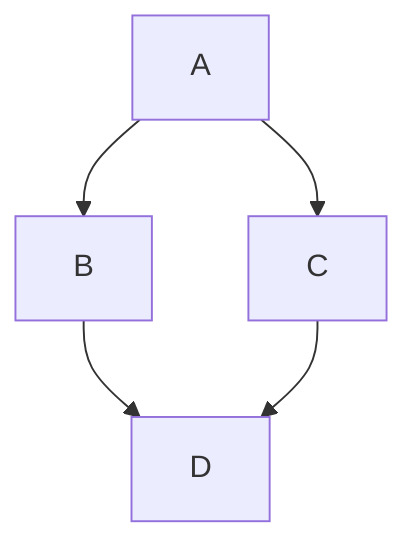

# Introduction

Research software tools, combined in computational workflows, are essential to modern, data-driven, life science. While resources such as InSoLito [REF] provides a network of co-citations of papers associated with software tools, Galaxy [REF] provides a tool recommender based on existing workflows, and Workflowmics [REF] explores new workflows based on annotations in bio.tools [REF], no effort have been so far been made to capture the order of tool citations and compare this with actual, directed, interoperability of tools in workflows. In this project, we bridged ordered citations from the Open Access literature in Europe PMC [REF] with Galaxy, Nextflow [REF] and Snakemake [REF] workflows, using research software annotated and associated with publications in bio.tools to predict tool interoperability from co-citations and visualize relationships between bioinformatics tools used in workflows, focusing on three main goals:

Goal 1:  Building directed graph of co-citations of papers associated with software tools in bio.tools. By analyzing the order in which publications associated with bio.tools entries are cited in open-access scientific articles, we infer potential relationships between tools. Unlike conventional undirected co-citation networks, the resulting graph captures citation order and distances, providing information about the sequence in which tools are likely used in computational analyses.

Goal 2: Comparing literature-derived relationships with computational workflows with the latter as ground-truth for the validation of the former. We explore tool dependencies and execution order from workflows deposited in WorkflowHub, including Galaxy and Nextflow workflows, as well as Nextflow workflows in nf-core, and Snakemake workflows from XXX (Julian), and compare these with relationships inferred from the literature. Specifically, we want to know how many co-citations, and with what distance between the citations in the publications, are needed to predict actual execution order in workflows.

Goal 3: Integrating directed tool relationships and visualize them in InSoLiTo. This requires a number of decisions on how to present directionality as well as source of the information shown, e.g. undirected co-citations from all literature, directed co-citations from Open Access subset of the literature, or actual workflows. This will enable users to explore not only which tools are frequently cited together, but also potential directional interoperability between them, providing a foundation for future applications such as software recommendation and automated workflow exploration [REF Workflowmics][REF Pubmetric].


# Methods

## Goal 1:  Building directed graph of co-citations of papers associated with software tools in bio.tools

Describe methodology here. How the literature was retrieved. Full set only (if we don't show the metabolomics and proteomics specifically). Link to Yojanas/Julians script in GitHub repo.

Network construction in Cytoscape?

Responsible: Yojana, Julian, Magnus?


## Goal 2: Comparing literature-derived relationships with computational workflows 

Describe methodology here. How the workflows were downloaded from the different sources, and tool edges edges constructed.

Responsible: Alma, Xenia, Julian

The nf-core community provides a collection of curated Nextflow workflows covering a wide range of bioinformatics applications. Nextflow represents workflows as collections of processes connected through channels that transfer data between them. Each process encapsulates a computational step, while workflow definitions specify how processes are invoked and connected.

The nf-core catalogue contained 160 workflows at the time of download (9 November 2026). For each workflow, we accessed its corresponding GitHub repository and downloaded the source files required for analysis. Fourteen workflows were archived and no longer actively maintained; these were retained to capture historical patterns of software integration. Two workflows were excluded because their repositories did not contain files compatible with our extraction method, resulting in a final dataset of 158 workflows.

We analysed the Nextflow scripts (main.nf and .nf files located in the workflows/, subworkflows/, and modules/ directories) obtained from these repositories to reconstruct process instances and their connections. Nextflow supports two workflow definition syntaxes: Domain Specific Language 1 (DSL1), the earlier syntax, and Domain Specific Language 2 (DSL2), which introduced a more modular approach to workflow organisation. For DSL2 workflows, we additionally collected module metadata (meta.yml) and software environment specifications (environment.yml). Archived workflows using DSL1 were processed with a separate parser to accommodate their different syntax and structure. As these workflows generally lack module metadata, software identification relied on container and Conda directives, as well as commands defined in process script blocks. Only text files were downloaded and analysed; none of the workflows were executed.

In Nextflow, a process represents an individual computational step, and each invocation of a process is referred to as a process instance. Each process instance was assigned to a software tool. For DSL2 workflows, tool identification followed a hierarchy based on module metadata (meta.yml), software packages specified in environment.yml, and, as a last resort, the module name.

Relationships between process instances were reconstructed from their inputs, outputs, and associated workflow information. We identified three types of relationships describing how software tools interact within a workflow:

- **Data flow:** An output produced by one process instance is passed as an input to another process instance.

- **Control/metadata relation:** Two process instances are linked through shared sample identifiers, execution results, or metadata, rather than through the direct transfer of an output file.

- **Parallel execution:** Two process instances consume the same input independently, without depending on each other's outputs or being connected by a dependency path, and can therefore execute independently within the same workflow run.

Each relationship was represented as a directed pair of software tools (A → B). Parallel relationships were recorded in both directions (A → B and B → A). Mutually exclusive process pairs, such as alternative alignment tools selected conditionally by a workflow parameter, were excluded.

Extracted software tools were mapped to the bio.tools registry to standardise their identification across workflows. For each tool, we collected available identifiers and references, including bio.tools identifiers, package names, DOIs, and homepage URLs.

Tools without an explicitly provided bio.tools identifier were searched in the registry using their exact names or DOIs. Generic command names (e.g. cat, find, and filter) and names describing computational operations (e.g. align and sort) were excluded from name-based matching. For composite names combining a software tool and an operation (e.g. star_align), the match was assigned to the underlying software tool (star) when a corresponding registry entry was available. For each successful match, we recorded the source used to establish the identifier, including module metadata, DOI, another identifier, homepage URL, or software name.

The extracted relationships were used to construct a directed software interaction network. Each node represented a unique software tool identified by a bio.tools identifier, and each edge represented an observed relationship between two tools within a workflow. Only relationships for which both participating tools had been successfully mapped to bio.tools were retained. Parallel relationships were represented by reciprocal directed edges. **TODO**: "paralel relationships were excluded from graph"???


## Goal 3: Integrating directed tool relationships and visualize them in InSoLiTo.

Responsible: Juancris


# Results

## Goal 1:  Building directed graph of co-citations of papers associated with software tools in bio.tools

Describe results here. Numbers of papers, citations and co-citations of papers in bio.tools, how long it took to download etc. How many nodes and edges in final network? Figure of network in Cytoscape (FIGURE)

Responsible: Yojana, Julian, Magnus?

## Goal 2: Comparing literature-derived relationships with computational workflows 

Describe results here. How many workflows were retrieved, how many components were matched to bio.tools entries, etc.

Comparison/agreement between co-citations and workflow order (FIGURES)

Responsible: Alma, Xenia, Julian, Vedran
The nf-core catalogue contained 160 workflows, of which 158 were included in the analysis. The final dataset comprised 146 DSL2 workflows and 12 DSL1 workflows. 634 tools were assigned a bio.tools identifier. A total of 541 tools were identified using information available directly from the workflow repositories, while an additional 93 were identified through matching against the local bio.tools registry. The resulting software interaction network comprised 434 unique nodes and 4,738 directed edges, representing 6,661 observed tool pairs.

## Goal 3: Integrating directed tool relationships and visualize them in InSoLiTo.

How the directed co-citation and workflow interoperability edges were incorporated and visualized in InSoLiTo. By default, we chose to display one edge, with source and target arrowheads, rather than two separate edges, for each source (co-citation, directed co-citation and workflows). Edge widths correspond to the number of co-citation or combination in workflows and relative arrowhead sizes the directedness of the edge.

Responsible: Juancris


# Discussion

Co-citations and existing workflows are complementary. Co-citations suggest sequentially used tools in data analysis methods that have never been combined in a scientific workflow. Conversely, some highly used tools, such as FastQC, have never been published in the peer-reviewed scientific literature, and therefore do not have any citations in any of the available literature databases.

The project revealed a number of tradeoffs between sensitivity and specificity, e.g. between capturing more co-citations between tools


# Conclusions and future work


Here are some general instructions for this Markdown:

## Tables

Tables can be added in the following way, though alternatives are possible:

```markdown
Table: Note that table caption is automatically numbered and should be
given before the table itself.

| Header 1 | Header 2 |
| -------- | -------- |
| item 1 | item 2 |
| item 3 | item 4 |
```

This gives:

Table: Note that table caption is automatically numbered and should be
given before the table itself.

| Header 1 | Header 2 |
| -------- | -------- |
| item 1 | item 2 |
| item 3 | item 4 |

## Figures

A figure is added with:

```markdown

```

This gives:


Figures can be scaled by adding the width or height to the Markdown like this:

```markdown
{ width=50px }
```

You can add cross references to figures by adding a LaTeX `\label{figureCode}` to
the label of the Markdown figure and then use `\ref{figureCode}` to cite it:

```markdown
{ width=50px }
```

This way, we can cite Figure \ref{figureCode}.

## Mermaid graphs

[Mermaid](https://mermaid.js.org/) provides a solution to put diagrams in Markdown. BioHackrXiv
added support for this in 2026. This is an example of embedding a graph:



# Other main section on your manuscript level 1

Lists can be added with:

1. Item 1
2. Item 2

# Citation Typing Ontology annotation

You can use [CiTO](http://purl.org/spar/cito/2018-02-12) annotations, as explained in [this BioHackathon Europe 2021 write up](https://raw.githubusercontent.com/biohackrxiv/bhxiv-metadata/main/doc/elixir_biohackathon2021/paper.md) and [this CiTO Pilot](https://www.biomedcentral.com/collections/cito).
Using this template, you can cite an article and indicate _why_ you cite that article, for instance DisGeNET-RDF [@citesAsAuthority:Queralt2016].

The syntax in Markdown is as follows: a single intention annotation looks like
`[@usesMethodIn:Krewinkel2017]`; two or more intentions are separated
with colons, like `[@extends:discusses:Nielsen2017Scholia]`. When you cite two
different articles, you use this syntax: `[@citesAsDataSource:Ammar2022ETL; @citesAsDataSource:Arend2022BioHackEU22]`.

Possible CiTO typing annotation include:

* citesAsDataSource: when you point the reader to a source of data which may explain a claim
* usesDataFrom: when you reuse somehow (and elaborate on) the data in the cited entity
* usesMethodIn
* citesAsAuthority
* citesAsEvidence
* citesAsPotentialSolution
* citesAsRecommendedReading
* citesAsRelated
* citesAsSourceDocument
* citesForInformation
* confirms
* documents
* providesDataFor
* obtainsSupportFrom
* discusses
* extends
* agreesWith
* disagreesWith
* updates

There is a general `cites` intention, but this is already implied and should be left out.

# Results


# Discussion

...

## Acknowledgements

...

# References

```{=latex}
\AtEndDocument{%
```

# Appendices

If you want the Appendix (-ces) to show up after the references, wrap them in 
after the header, like done in this Markdown file. Look at the [source](paper.md)
to see the exact structure.

```{=latex}
}
```
