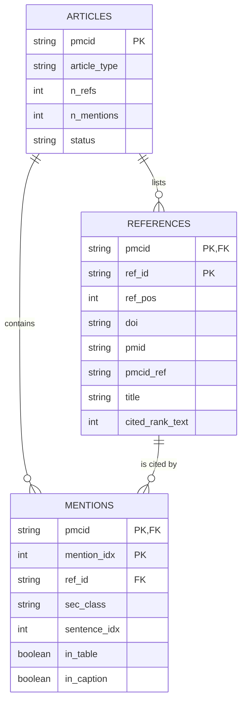
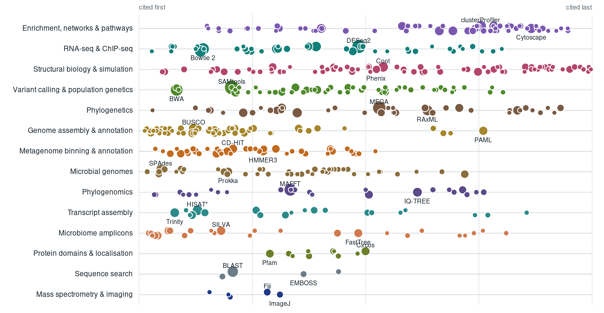
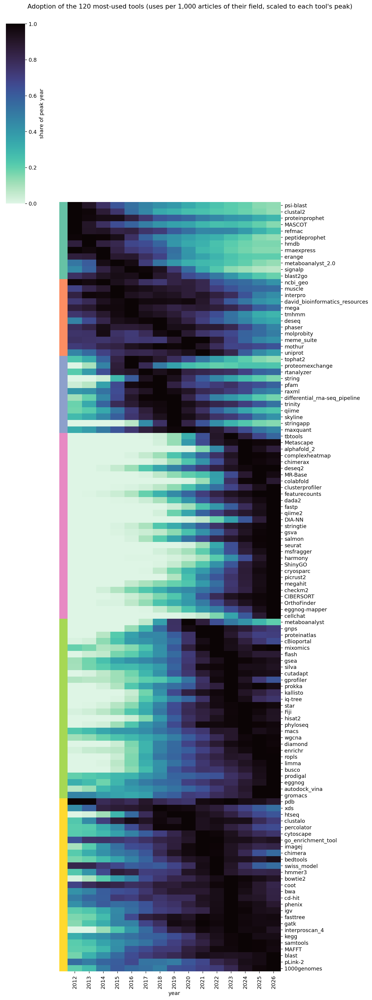

# Introduction

Research software tools, combined in computational workflows, are essential to modern, data-driven, life science. While resources such as InSoLiTo [@AguiloCastillo2022] provides a network of co-citations of papers associated with software tools, Galaxy [@GalaxyCommunity2026] provides a tool recommender based on existing workflows, and Workflowmics [REF] explores new workflows based on annotations in bio.tools [@Ison2019], no effort have been so far been made to capture the order of tool citations and compare this with actual, directed, interoperability of tools in workflows. In this project, we bridged ordered citations from the Open Access literature in Europe PMC [@Rosonovski2024] with Galaxy, Nextflow [@DiTommaso2017] and Snakemake [@Molder2021] workflows, using research software annotated and associated with publications in bio.tools to predict tool interoperability from co-citations and visualize relationships between bioinformatics tools used in workflows, focusing on three main goals:

Goal 1:  Building directed graph of co-citations of papers associated with software tools in bio.tools. By analyzing the order in which publications associated with bio.tools entries are cited in open-access scientific articles, we infer potential relationships between tools. Unlike conventional undirected co-citation networks, the resulting graph captures citation order and distances, providing information about the sequence in which tools are likely used in computational analyses.

Goal 2: Comparing literature-derived relationships with computational workflows with the latter as ground-truth for the validation of the former. We explore tool dependencies and execution order from workflows deposited in WorkflowHub, including Galaxy and Nextflow workflows, as well as Nextflow workflows in nf-core, and Snakemake workflows from XXX (Julian), and compare these with relationships inferred from the literature. Specifically, we want to know how many co-citations, and with what distance between the citations in the publications, are needed to predict actual execution order in workflows.

Goal 3: Integrating directed tool relationships and visualize them in InSoLiTo. This requires a number of decisions on how to present directionality as well as source of the information shown, e.g. undirected co-citations from all literature, directed co-citations from Open Access subset of the literature, or actual workflows. This will enable users to explore not only which tools are frequently cited together, but also potential directional interoperability between them, providing a foundation for future applications such as software recommendation and automated workflow exploration [REF Workflowmics][REF Pubmetric].


# Methods

## Goal 1:  Building directed graph of co-citations of papers associated with software tools in bio.tools

### Corpus generation

Full-text articles were taken from the Open Access subset of Europe PMC [@citesAsDataSource:Rosonovski2024] as JATS XML. The complete Open Access corpus was downloaded with [`download_europepmc_bulk.py`](https://github.com/inab/BH2026-InSoLiTo/blob/BH2026/directed-graph/europepmc/download_europepmc_bulk.py) from the EBI bulk dump (about 1,300 weekly-regenerated bundles, about 173 GB compressed, about 7.4 million articles with a reference list); fetching each article through the API would take about 11 days. **[TODO: Julian]** final article count and date of the bulk download. For smaller corpora, such as a single research field, [`download_europepmc.py`](https://github.com/inab/BH2026-InSoLiTo/blob/BH2026/directed-graph/europepmc/download_europepmc.py) searches the Europe PMC REST API with `(topic) AND OPEN_ACCESS:Y AND HAS_REFLIST:Y` and fetches each matching article; it is resumable, rate-limited, and records every article and its download status in a manifest. Both write the articles to the same files, so the parsing steps that follow are the same for either.

[`parse_jats.py`](https://github.com/inab/BH2026-InSoLiTo/blob/BH2026/directed-graph/europepmc/parse_jats.py) turns the XML into three tables:

- *articles*: one row per article, with its PMCID, article type, parse status and counts of references, mentions and sections (identifiers, year and journal come from the download manifest);
- *references*: one row per entry of the reference list, with its DOI, PMID and PMCID where given, and the rank at which it is first cited in the text;
- *mentions*: one row per in-text citation, with its position in the text, the section it occurs in (introduction, methods, results, discussion, other), and whether it sits in a table or figure caption.

The tables are linked by the citing article's PMCID and, within an article, by the reference's identifier in the reference list (Figure \ref{fig:schema}).



Figure: Schema of the three tables written by `parse_jats.py` (main columns only). A reference is identified by `(pmcid, ref_id)`; a mention by `(pmcid, mention_idx)` and points to the reference it cites. \label{fig:schema}

Citation ranges such as "[3–7]" are expanded into the individual references, and section headings are classified from their titles. DOIs are normalised (case, URL prefixes, trailing punctuation and file suffixes). **[TODO: Julian]** number of references and in-text mentions in the full corpus.

Many tools are first published as preprints. A bio.tools entry may list only the preprint, while citing articles cite the journal version, or the other way round. `resolve_preprints.py` therefore looks up every bioRxiv and medRxiv DOI in the corpus, first in Crossref (the `is-preprint-of` relation) and otherwise through the bioRxiv API. Each preprint is then mapped to its published version, so that both count as one paper, which brings tools listed in bio.tools only by their preprint into the graph. The scripts are in the `directed-graph/europepmc/` folder of the project repository. **[TODO: Julian]** confirm the preprint mapping was applied to the full-corpus edge list.

### Directed edges

**[TODO: Juancris]** 

### Graph cleaning and analysis

**[TODO: Julian]** 

## Goal 2: Comparing literature-derived relationships with computational workflows 

Describe methodology here. How the workflows were downloaded from the different sources, and tool edges edges constructed.

Responsible: Alma, Xenia, Julian

The nf-core community provides a collection of curated Nextflow workflows covering a wide range of bioinformatics applications. Nextflow represents workflows as collections of processes connected through channels that transfer data between them. Each process encapsulates a computational step, while workflow definitions specify how processes are invoked and connected.

The nf-core catalogue contained 160 workflows at the time of download (9 November 2026). For each workflow, we accessed its corresponding GitHub repository and downloaded the source files required for analysis. Fourteen workflows were archived and no longer actively maintained; these were retained to capture historical patterns of software integration. Two workflows were excluded because their repositories did not contain files compatible with our extraction method, resulting in a final dataset of 158 workflows.

We analysed the Nextflow scripts (main.nf and .nf files located in the workflows/, subworkflows/, and modules/ directories) obtained from these repositories to reconstruct process instances and their connections. Nextflow supports two workflow definition syntaxes: Domain Specific Language 1 (DSL1), the earlier syntax, and Domain Specific Language 2 (DSL2), which introduced a more modular approach to workflow organisation. For DSL2 workflows, we additionally collected module metadata (meta.yml) and software environment specifications (environment.yml). Archived workflows using DSL1 were processed with a separate parser to accommodate their different syntax and structure. As these workflows generally lack module metadata, software identification relied on container and Conda directives, as well as commands defined in process script blocks. Only text files were downloaded and analysed; none of the workflows were executed.

In Nextflow, a process represents an individual computational step, and each invocation of a process is referred to as a process instance. Each process instance was assigned to a software tool. For DSL2 workflows, tool identification followed a hierarchy based on module metadata (meta.yml), software packages specified in environment.yml, and, as a last resort, the module name.

Relationships between process instances were reconstructed from their inputs, outputs, and associated workflow information. We identified three types of relationships describing how software tools interact within a workflow:

- **Data flow:** An output produced by one process instance is passed as an input to another process instance.

- **Control/metadata relation:** Two process instances are linked through shared sample identifiers, execution results, or metadata, rather than through the direct transfer of an output file.

- **Parallel execution:** Two process instances consume the same input independently, without depending on each other's outputs or being connected by a dependency path, and can therefore execute independently within the same workflow run.

Each relationship was represented as a directed pair of software tools (A → B). Parallel relationships were recorded in both directions (A → B and B → A). Mutually exclusive process pairs, such as alternative alignment tools selected conditionally by a workflow parameter, were excluded.

Extracted software tools were mapped to the bio.tools registry to standardise their identification across workflows. For each tool, we collected available identifiers and references, including bio.tools identifiers, package names, DOIs, and homepage URLs.

Tools without an explicitly provided bio.tools identifier were searched in the registry using their exact names or DOIs. Generic command names (e.g. cat, find, and filter) and names describing computational operations (e.g. align and sort) were excluded from name-based matching. For composite names combining a software tool and an operation (e.g. star_align), the match was assigned to the underlying software tool (star) when a corresponding registry entry was available. For each successful match, we recorded the source used to establish the identifier, including module metadata, DOI, another identifier, homepage URL, or software name.

The extracted relationships were used to construct a directed software interaction network. Each node represented a unique software tool identified by a bio.tools identifier, and each edge represented an observed relationship between two tools within a workflow. Only relationships for which both participating tools had been successfully mapped to bio.tools were retained. Parallel relationships were represented by reciprocal directed edges. **TODO**: "paralel relationships were excluded from graph"???


## Goal 3: Integrating directed tool relationships and visualize them in InSoLiTo.

Responsible: Juancris


# Results

## Goal 1:  Building directed graph of co-citations of papers associated with software tools in bio.tools

The all-publications edge list had one node for each of 19,547 bio.tools entries. Cleaning dropped 1,156 entries that own no paper, mostly wrappers: `samtools_sort`, `samtools_flagstat` and `sam_to_bam` each had as many links as SAMtools itself. It also merged duplicate and copy entries. The cleaned graph has 17,955 tools and 963,846 tool pairs, of which 3,783 tools and 91,923 pairs are seen in at least 10 articles ([`12_all_publications_graph.py`](https://github.com/inab/BH2026-InSoLiTo/blob/BH2026/directed-graph/patterns/12_all_publications_graph.py)).

These pairs form 14 workflow areas (Figure \ref{fig:areas}). The largest are enrichment and networks, RNA-seq, structural biology, variant calling and phylogenetics, each with 10–12% of all links. Mass spectrometry tools form a small area of their own with Fiji and ImageJ, linked mostly to enrichment and RNA-seq tools. Cytoscape is where workflows lead most often (highest PageRank). DESeq2, MEGA, Coot, SAMtools and Fiji lie on the most paths between other tools. SAMtools, Bowtie 2, MAFFT and BLAST bridge the most areas ([`13_allpub_structure.py`](https://github.com/inab/BH2026-InSoLiTo/blob/BH2026/directed-graph/patterns/13_allpub_structure.py)).


Most tool pairs have a clear citation order: of the pairs seen in at least 10 articles, 82% are cited in the same order in at least 60% of their articles, and 43% in at least 80%. Of pairs seen in 200 or more articles, 23% are tight (adjacency at least 0.6) and 12% loose (below 0.25). A quarter of the strong one-way arrows (80% one way, 100+ articles) are loose. Most of these are separate analyses in the same paper, such as BUSCO and RAxML in genome papers. Using only neighbouring citations gives short, recognisable pipelines (Table \ref{tab:chains}; [`15_allpub_steps.py`](https://github.com/inab/BH2026-InSoLiTo/blob/BH2026/directed-graph/patterns/15_allpub_steps.py)).

Table: Pipeline chains from neighbouring citations: B is A's most common next tool, and A is one of B's two most common previous tools. Numbers are the summed 1/`tool_gap` per step, about the number of articles citing the two tools next to each other. \label{tab:chains}

| Chain | Weight per step |
| ----- | --------------- |
| STAR → DESeq2 → clusterProfiler → GOplot | 6,779; 5,467; 372 |
| BWA → SAMtools → bedtools | 8,908; 3,048 |
| XDS → Coot → MolProbity | 2,649; 3,892 |
| QIIME 2 → SILVA → phyloseq | 2,295; 2,778 |
| MetaBAT 2 → CheckM → GTDB-Tk | 1,079; 1,061 |
| SPAdes → Prokka → Roary | 1,420; 1,492 |
| trimAl → IQ-TREE → UFBoot2 | 1,273; 2,495 |
| SerialEM → MotionCor2 → cryoSPARC | 871; 1,570 |
| AutoDock Vina → GROMACS → ACPYPE → MDAnalysis | 822; 811; 325 |

The position of each tool from first to last step agrees with what its EDAM operations suggest (Pearson r = 0.75 for the 243 positioned tools whose EDAM operations were retrieved; Figure \ref{fig:position}). Sequencing quality control, genome assembly and read mapping come first; enrichment, pathway analysis and network visualisation come last. The largest mismatches point at annotations. MaxQuant, for example, lists imputation, clustering, heat maps and statistics, but papers cite it as the first processing step.



## Goal 2: Comparing literature-derived relationships with computational workflows 

Describe results here. How many workflows were retrieved, how many components were matched to bio.tools entries, etc.

Comparison/agreement between co-citations and workflow order (FIGURES)

Responsible: Alma, Xenia, Julian, Vedran
The nf-core catalogue contained 160 workflows, of which 158 were included in the analysis. The final dataset comprised 146 DSL2 workflows and 12 DSL1 workflows. 634 tools were assigned a bio.tools identifier. A total of 541 tools were identified using information available directly from the workflow repositories, while an additional 93 were identified through matching against the local bio.tools registry. The resulting software interaction network comprised 434 unique nodes and 4,738 directed edges, representing 6,661 observed tool pairs.

## Goal 3: Integrating directed tool relationships and visualize them in InSoLiTo.

How the directed co-citation and workflow interoperability edges were incorporated and visualized in InSoLiTo. By default, we chose to display one edge, with source and target arrowheads, rather than two separate edges, for each source (co-citation, directed co-citation and workflows). Edge widths correspond to the number of co-citation or combination in workflows and relative arrowhead sizes the directedness of the edge.

Responsible: Juancris


## Goal 4: Improving bio.tools annotations

Building the graph exposed problems in how [bio.tools](https://bio.tools/) entries list their publications. Each kind of problem changes which citations a tool gets, so we turned them into fix lists for the bio.tools community (Table \ref{tab:biotools}): [`biotools_preprint_links.csv`](https://github.com/inab/BH2026-InSoLiTo/blob/BH2026/directed-graph/biotools/data/biotools_preprint_links.csv) for preprints (from [`report_preprint_links.py`](https://github.com/inab/BH2026-InSoLiTo/blob/BH2026/directed-graph/biotools/report_preprint_links.py)), and [`biotools_fix_list.csv`](https://github.com/inab/BH2026-InSoLiTo/blob/BH2026/directed-graph/biotools/data/biotools_fix_list.csv) for the other issues (from [`14_biotools_audit.py`](https://github.com/inab/BH2026-InSoLiTo/blob/BH2026/directed-graph/patterns/14_biotools_audit.py)).

Table: bio.tools publication issues found from citation data. Citation counts are from the proteomics and metabolomics test corpus. \label{tab:biotools}

| Issue | Entries | Examples |
| ----- | ------: | -------- |
| Preprint listed, published version missing | 2,342 | 13,233 corpus citations of the published versions against 332 of the preprints |
| Heavily cited paper missing from the entry (cited at least as often as all listed papers together) | 401 | PRIDE 2019 and 2022, edgeR, RSEM, XCMS (2006), MZmine 2, MS-DIAL, SIRIUS 4 |
| Entry lists another tool's more-cited paper | 49 | QuasR and SpliceMap list HISAT; bcftools lists SAMtools |
| Entry lists papers but owns none (wrappers, platform listings) | 1,054 | `samtools_sort`, `pysam`, EBI and Ensembl BLAST services |

The missing papers have the largest effect on individual tools. The XCMS entry lists only its 2025 paper (3 citing articles in the test corpus), while the 2006 paper is cited by 1,498. The PRIDE entry lists a 2008 protocol chapter (4 citations), while its 2019 and 2022 database papers are cited by more than 5,700 articles together. bio.tools' `sirius` entry describes the Rdisop R package, and SIRIUS 4 and CSI:FingerID have no entry at all.


# Discussion

Co-citations and existing workflows are complementary. Co-citations suggest sequentially used tools in data analysis methods that have never been combined in a scientific workflow. Conversely, some highly used tools, such as FastQC, have never been published in the peer-reviewed scientific literature, and therefore do not have any citations in any of the available literature databases.

[TODO: Add summary here from the combined network]

The project revealed a number of tradeoffs between sensitivity and specificity, e.g. between capturing more co-citations between tools and counting only those that reflect real use. Counting citations in the Methods section only, excluding tables and captions, and requiring a minimum number of articles all favour specificity. Mapping wrapper entries and preprints to the tool they describe gains sensitivity, but depends on the quality of bio.tools metadata. That metadata limits any citation-based graph: a tool whose entry lists the wrong or only a recent paper is under-counted or missing (XCMS, PRIDE), and an entry that lists another tool's paper inherits its citations.

Other limitations: only Open Access full text was used, which under-represents some fields and journals; tools are only counted when their papers are cited, so unpublished tools are invisible; the workflow mappings to bio.tools contain some noise, which we limited with the mapping confidence levels; and the all-publications edge list has no publication years, so time trends could only be studied in the proteomics and metabolomics corpus (Appendix).

# Conclusions and future work

Citation order in the Methods sections of the Open Access literature gives a directed tool graph whose arrows agree with the order of tools in registered workflows, and which covers parts of practice that workflows do not: downstream statistics, enrichment and interpretation, interactive tools, and whole fields such as structural biology and mass spectrometry. Registered workflows cover a small share of what the literature describes, so the two sources are best used together.

Next steps are next-tool suggestions that combine both sources, weighted by adjacency; feeding the bio.tools fix lists back to the registry and its curators; per-year edges for the full corpus, to follow how workflows change over time; and **[TODO: Juancris]** the InSoLiTo integration.

## Acknowledgements

...

# References

```{=latex}
\AtEndDocument{%
```

# Appendices

## Appendix A: proteomics and metabolomics case study

The topic corpus of 266,875 proteomics and metabolomics articles has publication years, so we used it to study how tool use changes over time. We took the 300 tools most used in the Methods sections of 201,521 research articles and added authors, institutions and yearly citation counts from OpenAlex [@citesAsDataSource:Priem2022] ([`directed-graph/patterns/`](https://github.com/inab/BH2026-InSoLiTo/blob/BH2026/directed-graph/patterns), steps 01–11).

- **Adoption.** Uses per 1,000 articles, adjusted for the field mix of each year, fall into six shapes (Figure \ref{fig:adoption}). 76 tools took off steeply around 2020 (AlphaFold 2, Seurat, DIA-NN), and 94 are past their peak (TopHat2, PeptideProphet, MaxQuant).
- **Updates.** A new paper on a tool takes a median of 10% of the tool's citations after one year and 20% after two. Compared with the tool's own earlier growth, it adds no extra growth (−0.03; 95% CI −0.07 to +0.01).
- **Developers.** Lab heads of the most-cited third of tools increase their output 1.74-fold after a tool's release, against 1.43-fold for the rest (p = 0.05).
- **In-group use.** 94.8% of uses are by other labs; 0.9% are by the tool's own authors and 4.3% by their institutions. Self-use falls from 3.7% in a tool's first two years to 0.5% after ten.
- **Workflow change.** Of the 200 most common arrows in 2012–14, 15 are still among the top 200 in 2024–26. Some tools moved between workflow areas: Prodigal, CD-HIT and eggNOG from sequence analysis to metagenomics, and Fiji from proteomics to RNA-seq. Time-lapse videos of the directed graph are in [`directed-graph/patterns/figures/`](https://github.com/inab/BH2026-InSoLiTo/blob/BH2026/directed-graph/patterns/figures).



```{=latex}
}
```
